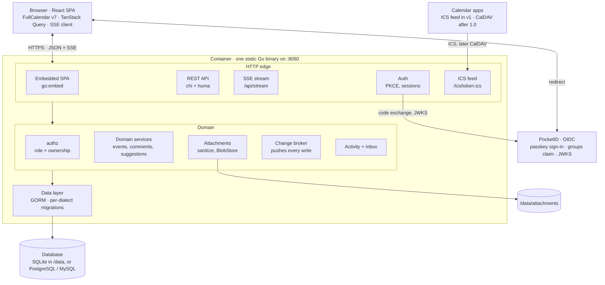
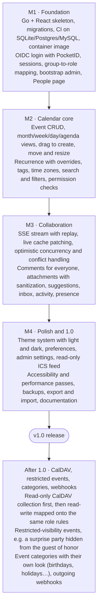

# SharedCal — Technical Specification

Version 1.1 · October 22, 2026 · License: MIT

---

## Brief for the implementing agent

You are building **SharedCal** from scratch, following this spec. Read it fully before writing code.

- **Build in milestone order** (see Roadmap): M1 Foundation → M2 Calendar core → M3 Collaboration → M4 Polish and 1.0. Each milestone must end with a green CI run and a working container image. Do not start CalDAV or restricted-visibility events; they are post-1.0.
- **Stack is decided** (see Technology stack). Do not substitute frameworks or libraries without flagging it as a deviation and explaining why.
- **Authorization is the core invariant.** All permission checks live in `internal/authz` as pure functions. Every handler calls them; the UI only hides what the server's `permissions` object says is not allowed. Write the exhaustive role × ownership × action test table before the handlers.
- **Three databases from day one.** Every migration is generated per dialect (SQLite, PostgreSQL, MySQL) and CI runs the full Go test suite against all three.
- **Treat uploads as hostile.** Follow the attachment pipeline and serving rules exactly.
- **Definition of done per feature:** server tests (including permission cases), a Playwright test for the user-facing flow, no new `govulncheck` / `npm audit` findings, works in light and dark mode, keyboard accessible.
- When the spec is silent, choose the simplest option consistent with it and record the decision in `docs/decisions.md`.

---

## Overview

**SharedCal** is a single shared calendar that a group of people log into with PocketID, see changes from each other live, and collaborate on through comments, attachments and suggested edits. It ships as one container image and runs on SQLite by default, since a typical deployment serves a small group; PostgreSQL or MySQL are drop-in alternatives. It is open source under the **MIT license**.

### Goals for v1

- One calendar per deployment. Every signed-in user sees the same calendar; there is no per-user calendar list to manage.
- Sign-in only through OIDC, tested first against PocketID. No local passwords.
- Three roles: **Viewer**, **Writer**, **Admin**, with ownership rules enforced on the server.
- Every signed-in user can comment. Writers can propose edits to events they don't own; owners or admins accept or reject. Events and comments can carry file attachments, sanitized and served safely.
- Live updates: a change made by one user appears on every open browser within about a second, with no refresh.
- A calm, polished interface: the calendar is the landing page, a narrow sidebar holds everything else. Light and dark mode at launch, with a theme system that lets new themes be added as data, not code changes.
- Deploy with one `docker run` (or a ten-line Compose file). All database access goes through an ORM so the backing database can change later.

### Non-goals for v1

- Multiple calendars, sub-calendars or per-team calendars (event **tags** cover most of that need).
- Restricted-visibility events (e.g. a surprise party hidden from the guest of honor). Planned for after 1.0; v1 keeps all authorization in one package so this becomes one new rule plus an audience table.
- CalDAV server. Planned after 1.0; v1 lays the groundwork (stable UIDs, iCalendar-compatible fields) and ships a read-only ICS feed as a stepping stone.
- Email or push notifications. Deliberately not planned: too intrusive for this kind of app. The in-app inbox and live badges are the only notification channel to people. Admin-configured **webhooks** (planned after 1.0) are an integration point, not a notification channel: SharedCal never contacts individual users itself.
- Local username/password accounts, mobile apps, resource/room booking.

## Technology stack

**Decision: a Go backend that embeds a React single-page app, compiled into one static binary in a ~25 MB distroless image.** Go gives a tiny, dependency-free container and first-class OIDC and SSE support; React is the only modern UI framework with a first-party, MIT-licensed adapter for FullCalendar v7, the strongest free calendar engine available today.

| Layer | Choice | Why |
| --- | --- | --- |
| Backend language | Go (current stable) | Single static binary, `CGO_ENABLED=0`, low memory, trivial cross-compile for amd64/arm64. Same language as PocketID, so self-hosters already trust the pattern. |
| HTTP router | `chi` on `net/http` | Thin, stdlib-compatible middleware; no framework lock-in. |
| API contract | OpenAPI 3.1 via `huma` | Handlers declare typed inputs/outputs; the spec is generated, and the TS client is generated from it with `openapi-typescript`, so frontend and backend types can't drift. |
| ORM | **GORM** | One set of model structs works on SQLite, PostgreSQL, MySQL/MariaDB and SQL Server. Largest Go ORM community. |
| Migrations | Atlas (`atlas-provider-gorm`) to generate, `golang-migrate` to apply | Versioned SQL migrations per dialect, generated from the GORM models and reviewed in PRs; applied automatically at startup. No `AutoMigrate` in production. |
| Default database | SQLite via pure-Go driver (`glebarez/sqlite` / `modernc`) | No CGO, no extra service. WAL mode. Right for the small groups SharedCal targets. |
| OIDC | `coreos/go-oidc` v3 + `golang.org/x/oauth2` | Discovery, JWKS rotation, ID-token verification, PKCE. Works with any compliant provider, not just PocketID. |
| Recurrence | `teambition/rrule-go` | RFC 5545 RRULE expansion on the server, so the API, ICS feed and future CalDAV share one implementation. |
| Live updates | Server-Sent Events + in-process pub/sub | One-directional push is all the calendar needs; works through every reverse proxy; auto-reconnects natively. |
| Attachments | `gabriel-vasile/mimetype` + `disintegration/imaging`, optional ClamAV | Magic-byte type detection and pure-Go image re-encoding keep the binary CGO-free; virus scanning is opt-in for installs that run clamd. |
| Frontend framework | React 19 + TypeScript, built with Vite as a static SPA | Embedded into the Go binary with `go:embed`; no Node.js at runtime. |
| Calendar engine | **FullCalendar v7** (MIT standard build) | Month/week/day/list views, drag-and-drop and resize in the free `interaction` plugin, dark mode in all themes, and a formal theme system with shadcn and Tailwind support. |
| UI components | shadcn/ui (Radix primitives) + Tailwind CSS v4 | Accessible primitives you own in the repo; themed entirely through CSS variables, which FullCalendar's shadcn theme also consumes. |
| Data fetching | TanStack Query | Cache keyed by date range; SSE messages patch or invalidate it. |
| Routing | TanStack Router | Type-safe routes and search params (e.g. `?view=week&date=2026-10-22`). |
| Forms and validation | React Hook Form + Zod | Zod schemas mirror the OpenAPI types. |
| Testing | Go `testing` + `testcontainers-go` (Postgres/MySQL); Vitest; Playwright end-to-end against a mock OIDC provider | Every migration and permission rule is tested on all supported databases in CI. |

### Alternatives considered

- **SvelteKit frontend** (PocketID's own choice). Lighter and pleasant to write, but FullCalendar v7 ships no Svelte adapter (Svelte is only on its roadmap), and Schedule-X moved drag-and-drop and resize to its paid tier in v4. Building a calendar engine from scratch is months of work. Revisit if FullCalendar ships a Svelte adapter.
- **Full-stack TypeScript (Node/Bun + Drizzle or Prisma).** One language end to end, but Drizzle schemas are written per dialect, Prisma fixes the provider per schema, and the image needs a JS runtime (roughly 4–6× larger).
- **Ent instead of GORM.** Stronger typing and graph traversal, but heavier codegen and a steeper curve for casual contributors. GORM plus Atlas gives the same versioned, multi-dialect migrations.
- **WebSockets instead of SSE.** Only needed for client-to-server streaming (e.g. live cursors). Mutations already go over REST, so SSE is simpler and enough.

## Roles and permissions

Every user has exactly one role; permissions are checked on the server for every request and mirrored in the UI only to hide controls. Ownership is the second axis: the user who created an event is its **owner**, and admins can transfer ownership.

| Action | Viewer | Writer | Admin |
| --- | --- | --- | --- |
| View calendar, events, comments, suggestions, attachments | Yes | Yes | Yes |
| Subscribe to the ICS feed | Yes | Yes | Yes |
| Comment on any event | Yes | Yes | Yes |
| Edit or delete own comment | Yes | Yes | Yes |
| Create an event | No | Yes | Yes |
| Edit or delete **own** event | No | Yes | Yes |
| Edit or delete **someone else's** event | No | No — suggest instead | Yes |
| Add or remove attachments on an event | No | On own events | On any event |
| Attach files to a comment | No | Yes | Yes |
| Suggest an edit to someone else's event | No | Yes | Yes (rarely needed) |
| Accept or reject suggestions | No | On own events | On any event |
| Delete anyone's comment or attachment | No | No | Yes |
| Manage users, roles, tags, themes, settings | No | No | Yes |
| View audit log | Own activity | Own activity | Everything |

### Rules

- **Default role.** A user signing in for the first time gets the role resolved from their OIDC groups (see Authentication). If no group matches, they get the configured `DEFAULT_ROLE` (default `viewer`), or are refused if `ALLOW_UNMAPPED_USERS=false`.
- **Role source.** Each user's role is either `idp` (recomputed from groups on every login) or `manual` (set by an admin in the app, which pins it until reset). This lets small installs manage roles in-app without touching PocketID.
- **Bootstrap admin.** `BOOTSTRAP_ADMIN_EMAIL` or `BOOTSTRAP_ADMIN_SUB` grants admin to that identity on first login, so a fresh install is never locked out.
- **Last admin protection.** The server refuses to demote or deactivate the last active admin.
- **Ownership transfer.** When a user is deactivated, their events stay; an admin can reassign them in bulk.

### Suggestion model

A suggestion is a proposed patch to an event, not a free-text note. A writer opens someone else's event, edits fields in the normal form, and submits; the server stores only the changed fields plus the event's `version` at that moment.

1. The owner (and admins) see a badge on the event and a notification in the sidebar inbox.
2. The review panel shows a field-by-field diff: current value, proposed value.
3. The reviewer can **accept all**, **accept selected fields**, or **reject** with an optional reason. Accepting applies the patch as a normal edit attributed to the reviewer, crediting the suggester in the activity log.
4. If the event changed after the suggestion was made, fields that conflict are flagged; the reviewer picks which value wins.
5. Suggestions are closed automatically when their event is deleted, and can be withdrawn by their author while open.

Writers may also suggest **deleting** an event (a suggestion with `kind = delete`), which keeps the flow uniform.

## Authentication

The app is a confidential OIDC client using the Authorization Code flow with PKCE, and maps PocketID user groups to app roles through the standard `groups` claim. It talks only to the provider's discovery document, so Authelia, Authentik, Keycloak or Zitadel work with no code changes.

### PocketID setup (documented in the README)

1. In PocketID, create an OIDC client named e.g. `sharedcal` with callback URL `https://cal.example.com/auth/callback` and logout callback `https://cal.example.com/`. Enable PKCE.
2. Create user groups such as `calendar-admins`, `calendar-writers`, `calendar-viewers`. PocketID emits group membership when the client requests the `groups` scope.
3. Optionally restrict the client to those groups under *Allowed user groups*, so only calendar members can sign in at all.
4. Copy the issuer URL, client ID and secret into the app's environment.

### Login flow

1. Unauthenticated request to any page → redirect to `/auth/login`.
2. The server creates `state`, `nonce` and a PKCE verifier, stores them in a short-lived (10 min) signed cookie, and redirects to the provider with scopes `openid profile email groups`.
3. `/auth/callback` checks `state`, exchanges the code, verifies the ID token signature, issuer, audience, expiry and `nonce`.
4. The user is looked up by `(issuer, sub)` — never by email — and created on first login. Display name, email, avatar URL and groups are refreshed from claims.
5. Role is resolved (below), then a server-side session row is created and its random 256-bit ID is set in an `HttpOnly`, `Secure`, `SameSite=Lax` cookie.
6. Redirect back to the page originally requested.

### Role mapping

| Variable | Example | Meaning |
| --- | --- | --- |
| `OIDC_ROLE_CLAIM` | `groups` | Claim holding an array of group names. |
| `OIDC_ADMIN_GROUPS` | `calendar-admins` | Comma-separated; membership in any → admin. |
| `OIDC_WRITER_GROUPS` | `calendar-writers` | → writer. |
| `OIDC_VIEWER_GROUPS` | `calendar-viewers` | → viewer. |
| `DEFAULT_ROLE` | `viewer` | Role when no group matches. |
| `ALLOW_UNMAPPED_USERS` | `true` | `false` refuses sign-in when no group matches. |

The highest matching role wins. Group matching is case-insensitive.

### Sessions

- Server-side sessions in the database (not JWTs in the browser), so an admin can revoke any session instantly and role changes take effect on the next request.
- Idle timeout 7 days, absolute lifetime 30 days, both configurable. Activity extends the idle window at most once per hour to limit writes.
- The provider's refresh token is not stored; when the app session ends, the user goes through the provider again, which with PocketID's passkeys is one tap.
- Logout deletes the session and calls the provider's `end_session_endpoint` when advertised (RP-initiated logout).
- An open SSE connection is closed by the server when its session is revoked or expires.

## Functional requirements

The calendar page does five things well: show events, create them in place, edit them by dragging, discuss them, and propose changes to them. Everything else is secondary.

### Calendar views

- **Month**, **Week**, **Day** and **Agenda** (a scrolling list of upcoming events). The last-used view and date are kept in the URL and in user preferences.
- Keyboard: `T` today, `←`/`→` previous/next, `M`/`W`/`D`/`A` switch view, `N` new event, `/` search, `Esc` close panel.
- Filter by tag and by owner; a free-text search over title, description and location.
- Responsive: on screens under 768 px the default view becomes Agenda and the sidebar collapses to a bottom bar.
- All times are stored in UTC with the event's IANA time zone, and displayed in the viewer's chosen time zone (defaulting to the browser's).

### Events

| Field | Notes |
| --- | --- |
| Title | Required, up to 200 characters. |
| Start / end | Date-time with time zone, or date-only for all-day events. Multi-day allowed. |
| All-day | Toggle. |
| Recurrence | RRULE from presets (daily, weekdays, weekly on…, monthly on the Nth…, yearly) or a custom builder; end by count or date. |
| Location | Free text; URLs become links. |
| Description | Markdown, sanitized on render. |
| Tags | Zero or more admin-defined tags, each with a name and a theme color token. The first tag sets the event color. |
| Status | `confirmed` or `tentative` (tentative shown with a hatched style). |
| Attachments | Zero or more files (see Attachments). |
| Owner | Set to the creator; changeable only by admins. |

**Creating:** click or drag across empty time slots to open a quick-create popover (title + time); "More options" opens the full side panel.

**Editing:** owners and admins drag to move and drag edges to resize. Writers dragging an event they don't own get a ghost preview and a prompt to **send it as a suggestion** instead.

**Recurring events:** editing an occurrence asks "This event / This and following / All events", stored as an override row (`RECURRENCE-ID` semantics) or an RRULE split, matching RFC 5545 so CalDAV export is lossless later.

**Deleting:** soft delete with a 30-day trash that admins can restore from; owners see an "Undo" toast for 10 seconds.

### Comments

- Open to every signed-in user, viewers included.
- Threaded one level deep (comment + replies), Markdown, `@mention` of any user.
- Shown in the event side panel under the details, newest at the bottom, updating live.
- Authors can edit (marked "edited") or delete their own; admins can delete any.
- Writers and admins can attach files to a comment (same rules as event attachments below).

### Attachments

Events and comments can carry files (agendas, flyers, maps, photos). Uploads are treated as hostile: the server verifies the real file type, re-encodes images, never renders untrusted formats inline, and serves every file so the browser cannot execute it.

**User-facing behavior**

- Drag files onto the event panel or comment box, or use an "Attach" button. Progress bar per file; uploads can be cancelled.
- Event attachments appear as a list in the Details tab; images show as a thumbnail strip with a lightbox; other files show icon, name, size and a download button.
- Defaults (configurable): 25 MB per file, 10 files per event, 5 files per comment, 2 GB total per instance.
- Removing an attachment is a soft delete (restorable by admins for 30 days, like events). Deleting an event removes its attachments with it.
- Attachment changes appear in the activity log and arrive live over SSE.

**Sanitization pipeline (server, in order)**

1. **Limit early:** enforce the size cap while streaming (`http.MaxBytesReader`), never buffering the whole file in memory.
2. **Detect the real type** from magic bytes (`gabriel-vasile/mimetype`), ignoring the client's `Content-Type`. The detected type must be on the allow-list *and* agree with the extension.
3. **Allow-list for v1:** PNG, JPEG, WebP, GIF; PDF; plain text, Markdown, CSV; iCalendar (`.ics`); DOCX, XLSX, PPTX, ODT, ODS, ODP. Everything else is refused, including SVG, HTML, XML, JavaScript, archives and executables.
4. **Images are re-encoded** in pure Go (`disintegration/imaging` on the standard decoders): decode with a pixel-count limit (40 MP) to stop decompression bombs, strip EXIF/GPS metadata, write a clean copy plus a 480 px thumbnail. The original bytes are discarded.
5. **Office and PDF files** are never parsed or previewed server-side in v1; they are stored as-is and offered only as downloads.
6. **Optional virus scan:** if `CLAMAV_ADDR` is set, the file is streamed to `clamd`; it stays `pending` (visible only to the uploader) until clean, and is deleted and logged if infected.
7. **Filename** is kept only as display metadata: path components and control characters stripped, Unicode-normalized, truncated to 200 characters.
8. **Storage** under `/data/attachments/<sha256-prefix>/<sha256>`, outside any served directory, behind a `BlobStore` interface so S3-compatible storage can be added later. Identical files are stored once.

**Serving rules**

- Only through `GET /api/attachments/{id}/content`, with the normal session check (or a short-lived signed URL for thumbnails).
- Headers on every response: `X-Content-Type-Options: nosniff`, `Content-Security-Policy: sandbox; default-src 'none'`, `Cross-Origin-Resource-Policy: same-origin`, and the stored, server-detected `Content-Type`.
- `Content-Disposition: attachment` for everything except re-encoded images and their thumbnails, which are served `inline`. The original filename goes in the RFC 6266 `filename*` parameter.

### Suggestions

As described under Roles and permissions: field-level patches with diff review, partial accept, conflict flags, and a sidebar inbox for owners.

### Activity and notifications

- Every mutation writes an `activity` row: who, what, when, before/after snapshot.
- Each event's side panel has a History tab; admins get a global Activity page.
- An in-app **Inbox** in the sidebar collects: suggestions on my events, replies and mentions, decisions on my suggestions. Unread count shown as a badge; delivered live over SSE.
- There are deliberately no email or push notifications; the in-app inbox and live badges are the only channel, which keeps the app quiet.

### Sidebar pages

| Page | Who | Contents |
| --- | --- | --- |
| Calendar | All | Landing page. |
| Inbox | All | Replies and mentions; suggestions on my events and decisions on mine. |
| Preferences | All | Theme, light/dark/system, time zone, week start day, 12/24-hour clock, default view, density. |
| Subscribe | All | Personal ICS feed URL with copy button and reset. |
| People | Admins | Users, roles, role source, sessions, deactivate. |
| Tags | Admins | Create, rename, recolor, reorder tags. |
| Activity | Admins | Filterable audit log. |
| Settings | Admins | Calendar name, default time zone, default role, branding (logo, accent), installed themes, attachment limits. |

## Real-time collaboration

Every browser holds one Server-Sent Events connection to `/api/stream`; after any successful write, the server publishes a small change message that every client applies to its cache, so other users see the change in under a second without refreshing.

### How a change propagates

1. User A saves an event via `PATCH /api/events/{id}`.
2. In the same database transaction, the server updates the event, increments its `version`, and appends a row to `change_log` with a monotonically increasing `seq`.
3. After commit, the server publishes `{seq, type, id, version, payload}` to the in-process broker.
4. The broker fans the message out to every open SSE connection, filtered by what that user may see (all events today; per-user inbox items only to their recipient; `pending` attachments only to their uploader).
5. Each client's TanStack Query cache patches the event in place for every loaded range it overlaps; FullCalendar re-renders just that event with a short highlight so users notice the change.

### Message types

`event.created`, `event.updated`, `event.deleted`, `comment.created`, `comment.updated`, `comment.deleted`, `attachment.added`, `attachment.removed`, `attachment.scanned`, `suggestion.created`, `suggestion.resolved`, `tag.changed`, `user.role_changed`, `inbox.item`, `presence`, `heartbeat`.

### Reconnect and catch-up

- Each message carries its `seq` as the SSE `id`. On reconnect the browser sends `Last-Event-ID`; the server replays everything after it from `change_log`.
- `change_log` is pruned after 24 hours. If a client's last ID is older than the oldest retained row, the server sends `resync` and the client refetches its visible range.
- A `heartbeat` comment every 25 seconds keeps proxies from closing idle connections. The README documents the one proxy setting that matters (disable response buffering for `/api/stream`).

### Conflicts

Optimistic concurrency, no locks. Every update sends `If-Match: <version>`. If someone else saved first, the server returns `409` with the current event; the client shows both versions side by side and lets the user re-apply their changes field by field. Drag-and-drop on a stale event rolls back and shows a toast.

### Presence (light)

While an event's side panel is open, the client sends a `viewing` heartbeat every 20 seconds (a tiny `POST`). Others see small avatars on that event ("Dana is viewing") and an "editing" indicator when the form is dirty. Presence is in-memory only and expires after 45 seconds of silence.

### Scaling note

The in-process broker is right for a single container. For multiple replicas behind a load balancer, the broker interface gets a PostgreSQL `LISTEN/NOTIFY` (or Redis) implementation; nothing else changes.

## UI/UX and theming

The calendar fills the screen; everything else lives in a 56 px icon rail that expands to 240 px on hover or pin, and in a right-hand side panel that slides over the calendar for event details. A theme is a JSON file of design tokens, so adding one never touches component code.

### Layout

- **Left rail:** logo/calendar name, then icons for Calendar, Inbox (with badge), Preferences, Subscribe; admin items below a divider; user avatar and sign-out at the bottom. Tooltips when collapsed.
- **Top bar inside the calendar:** Today, ◀ ▶, the current period as a large title ("October 2026"), view switcher as a segmented control, search, and "+ New event" for writers.
- **Side panel (420 px):** event details with tabs for Details (including attachments), Comments, Suggestions, History. Opens on event click, deep-linkable as `/?event=<id>`. On mobile it becomes a full-height sheet.
- **Empty, loading and offline states** are designed, not defaults: skeleton grid while loading, a quiet banner "Reconnecting…" when SSE drops.

### Visual principles

- Neutral surfaces, a single accent color, and tag colors as the only other hues.
- Generous whitespace, one type family (Inter or Geist, self-hosted), tabular numerals for times.
- Motion only to explain change: 150 ms panel slides, a 600 ms glow when a remote edit lands. Respect `prefers-reduced-motion`.
- WCAG 2.2 AA contrast in every shipped theme, checked in CI; full keyboard navigation; FullCalendar v7's focus styles kept.

### Theme system

Themes are token sets that compile to CSS custom properties. shadcn/ui and FullCalendar's shadcn theme both read the same variables, so one file restyles the whole app including the calendar grid.

```json
{
  "id": "nord",
  "name": "Nord",
  "author": "community",
  "modes": {
    "light": { "background": "#eceff4", "foreground": "#2e3440", "primary": "#5e81ac", "muted": "#e5e9f0", "border": "#d8dee9", "radius": "0.5rem",
               "tag-1": "#bf616a", "tag-2": "#d08770", "tag-3": "#a3be8c", "tag-4": "#b48ead" },
    "dark":  { "background": "#2e3440", "foreground": "#eceff4", "primary": "#88c0d0", "muted": "#3b4252", "border": "#434c5e", "radius": "0.5rem",
               "tag-1": "#bf616a", "tag-2": "#d08770", "tag-3": "#a3be8c", "tag-4": "#b48ead" }
  }
}
```

- **Built in:** `default` (light + dark) at launch; one or two extra community-style themes are a good first contributor task.
- **Install more:** drop JSON files into `/data/themes/` or upload through Settings → Themes. The server validates the schema and contrast before enabling.
- **Per-user choice:** theme + mode (`light`, `dark`, `system`). Stored in the user's preferences and mirrored to `localStorage` so the first paint is correct with no flash.
- **Tag colors are slots, not hex values:** a tag stores `tag-3`, and each theme defines what `tag-3` looks like in light and dark. Event colors therefore stay readable in every theme.
- **Admin branding:** calendar name, logo and accent override, applied on top of whichever theme the user picks.

## Architecture

A single Go process serves the static React app, the REST API, the SSE stream and the ICS feed; every write passes through the authorization layer and the domain services, commits through GORM, and is then pushed to all connected browsers by the change broker.



The browser talks only to the container; PocketID is reached by redirect for sign-in and by the server for token exchange. The change broker is the only piece that changes if the app ever runs as several replicas.

### Write path (example: moving an event)

1. FullCalendar fires `eventDrop`; the client optimistically moves the event and sends `PATCH /api/events/{id}` with `If-Match`.
2. Middleware loads the session, then `authz.CanEdit(user, event)` decides: allowed, suggest-only, or forbidden.
3. The event service validates, writes the event, an `activity` row and a `change_log` row in one transaction.
4. On commit the broker publishes; every other open browser patches its cache. The author's client confirms its optimistic update with the new `version`.

### Repository layout

```
/cmd/sharedcal         main.go, CLI subcommands (serve, migrate, backup, export, import)
/internal/config       env parsing and validation
/internal/auth         OIDC client, sessions, CSRF
/internal/authz        permission rules (pure functions, exhaustively tested)
/internal/domain       events, recurrence, comments, suggestions, tags, users
/internal/attachments  upload pipeline, type detection, image re-encoding, BlobStore, ClamAV client
/internal/store        GORM models and repositories
/internal/realtime     broker interface, in-process implementation, SSE handler
/internal/api          huma operations, OpenAPI generation
/internal/ics          iCalendar serialization (shared with future CalDAV)
/migrations/{sqlite,postgres,mysql}
/web                   React app (Vite); built into /web/dist and embedded
/web/src/themes        built-in theme JSON files
/deploy                Dockerfile, compose examples, proxy snippets
/docs                  README material, decisions.md
```

## Data model

Fifteen tables, all with UUIDv7 primary keys (time-ordered, safe to expose, valid as iCalendar `UID`s) and `created_at`/`updated_at` timestamps in UTC. Types are portable across SQLite, PostgreSQL and MySQL: no arrays, JSON stored as text, enums as short strings with check constraints.

| Table | Key fields | Notes |
| --- | --- | --- |
| `users` | `id`, `oidc_issuer`, `oidc_subject`, `email`, `display_name`, `avatar_url`, `role`, `role_source` (`idp`/`manual`), `groups_json`, `active`, `last_login_at` | Unique on `(oidc_issuer, oidc_subject)`. |
| `user_preferences` | `user_id`, `theme_id`, `color_mode`, `time_zone`, `week_start`, `clock_24h`, `default_view`, `density` | One row per user. |
| `sessions` | `id` (hashed), `user_id`, `expires_at`, `idle_expires_at`, `ip`, `user_agent`, `created_at` | Session ID stored as SHA-256 hash only. |
| `events` | `id`, `owner_id`, `title`, `description`, `location`, `start_at`, `end_at`, `all_day`, `time_zone`, `rrule`, `exdates_json`, `status` (`confirmed`/`tentative`), `version`, `deleted_at` | `version` drives optimistic concurrency. Index on `(start_at, end_at)` and `deleted_at`. |
| `event_overrides` | `id`, `event_id`, `recurrence_id` (original start), fields as `events`, `cancelled` | One row per modified or cancelled occurrence. |
| `tags` | `id`, `name`, `color_slot`, `sort_order` | Admin-managed. |
| `event_tags` | `event_id`, `tag_id`, `position` | Ordered join table. |
| `comments` | `id`, `event_id`, `author_id`, `parent_id`, `body`, `edited_at`, `deleted_at` | `parent_id` null for top-level. |
| `attachments` | `id`, `event_id`, `comment_id` (nullable), `uploader_id`, `filename`, `content_type`, `size_bytes`, `sha256`, `storage_key`, `width`, `height`, `thumb_key`, `scan_status` (`pending`/`clean`/`infected`/`skipped`), `deleted_at` | Belongs to an event, optionally to a comment on it. Blob stored once per sha256; rows reference it. |
| `suggestions` | `id`, `event_id`, `author_id`, `kind` (`edit`/`delete`), `patch_json`, `base_version`, `status` (`open`/`accepted`/`partially_accepted`/`rejected`/`withdrawn`/`closed`), `reviewer_id`, `review_note`, `resolved_at` | `patch_json` holds only changed fields. |
| `notifications` | `id`, `user_id`, `kind`, `subject_type`, `subject_id`, `actor_id`, `read_at` | Backs the Inbox. |
| `activity` | `id`, `actor_id`, `action`, `subject_type`, `subject_id`, `before_json`, `after_json`, `created_at` | Append-only audit log. |
| `change_log` | `seq` (auto-increment), `type`, `subject_id`, `payload_json`, `created_at` | SSE replay buffer, pruned after 24 h. |
| `feed_tokens` | `id`, `user_id`, `token_hash`, `created_at`, `last_used_at` | Personal ICS feed secrets. |
| `settings` | `key`, `value_json` | Instance settings edited in the UI. |

Themes uploaded through the UI are stored in `settings` (or on disk under `/data/themes`) rather than their own table, keeping the schema small.

## API

A JSON REST API under `/api`, described by a generated OpenAPI 3.1 document at `/api/openapi.json`, plus one SSE stream. The browser authenticates with the session cookie; state-changing requests also require a CSRF header (`X-CSRF-Token`, double-submit). Errors use RFC 9457 problem+json.

| Method | Path | Role | Purpose |
| --- | --- | --- | --- |
| GET | `/auth/login` | — | Start OIDC flow. |
| GET | `/auth/callback` | — | Finish OIDC flow, set session. |
| POST | `/auth/logout` | Any | End session; return provider logout URL. |
| GET | `/api/me` | Any | Current user, role, preferences, CSRF token. |
| PUT | `/api/me/preferences` | Any | Update preferences. |
| GET | `/api/events?from=&to=&tag=&owner=&q=` | Viewer+ | Occurrences in range, recurrences expanded server-side. |
| GET | `/api/events/{id}` | Viewer+ | Single event (master, with overrides and attachments). |
| POST | `/api/events` | Writer+ | Create. |
| PATCH | `/api/events/{id}` | Owner/Admin | Update; requires `If-Match`. Recurring events take `scope` (`this`, `following` or `all`) plus `occurrence`. |
| DELETE | `/api/events/{id}` | Owner/Admin | Soft delete; same scope parameters. |
| POST | `/api/events/{id}/restore` | Admin | Restore from trash. |
| GET, POST | `/api/events/{id}/comments` | Viewer+ | List / add. |
| PATCH, DELETE | `/api/comments/{id}` | Author/Admin | Edit / delete. |
| GET, POST | `/api/events/{id}/suggestions` | Viewer+ / Writer+ | List / propose. |
| POST | `/api/suggestions/{id}/accept` | Owner/Admin | Body: list of field names (empty = all) and conflict choices. |
| POST | `/api/suggestions/{id}/reject` | Owner/Admin | Optional note. |
| POST | `/api/suggestions/{id}/withdraw` | Author | Withdraw. |
| POST | `/api/events/{id}/attachments` | Owner/Admin | Multipart upload to an event; returns the attachment with scan status. |
| POST | `/api/comments/{id}/attachments` | Comment author (Writer+) | Multipart upload to a comment. |
| GET | `/api/attachments/{id}/content`, `/api/attachments/{id}/thumb` | Viewer+ | Download or inline image, with the serving headers from Attachments. |
| DELETE | `/api/attachments/{id}` | Uploader, event owner, Admin | Soft delete. |
| GET | `/api/events/{id}/history` | Viewer+ | Activity for one event. |
| GET, POST | `/api/inbox`, `/api/inbox/read` | Viewer+ | List, mark read. |
| POST | `/api/presence` | Viewer+ | `{event_id, state}` heartbeat. |
| GET | `/api/stream` | Viewer+ | SSE stream (see Real-time). |
| GET, POST, PATCH, DELETE | `/api/tags…` | Viewer+ read, Admin write | Tags. |
| GET, PATCH | `/api/users…` | Admin | List users, change role/role source, deactivate, revoke sessions, transfer ownership. |
| GET | `/api/activity` | Admin | Audit log with filters. |
| GET, PUT | `/api/settings` | Admin | Instance settings. |
| GET, POST, DELETE | `/api/themes…` | Any read, Admin write | List, upload, remove themes. |
| POST | `/api/me/feed-token` | Any | Create or rotate personal ICS token. |
| GET | `/ics/{token}.ics` | Token | Read-only iCalendar feed. |
| GET | `/healthz`, `/readyz` | — | Liveness, readiness (DB reachable, migrations applied). |
| GET | `/metrics` | — (optional, bind-restricted) | Prometheus metrics. |

### Event payload

```json
{
  "id": "01928f3e-7c4a-7b2e-9a1d-3f6c2e8b4d10",
  "title": "Board game night",
  "start": "2026-10-30T19:00:00",
  "end": "2026-10-30T23:00:00",
  "timeZone": "America/New_York",
  "allDay": false,
  "rrule": "FREQ=WEEKLY;BYDAY=FR",
  "location": "Dana's place",
  "description": "Bring snacks.",
  "tags": ["t_social"],
  "status": "confirmed",
  "owner": { "id": "…", "name": "Dana", "avatarUrl": "…" },
  "version": 4,
  "permissions": { "edit": false, "delete": false, "suggest": true, "comment": true, "attach": false },
  "counts": { "comments": 3, "openSuggestions": 1, "attachments": 2 }
}
```

The server computes `permissions` per request so the UI never re-implements the rules; it only hides what the server says is not allowed.

## Deployment and configuration

One multi-arch image (`linux/amd64`, `linux/arm64`) built from `gcr.io/distroless/static`, running as a non-root user, listening on port 8080, with all state in a single `/data` volume (database file and attachments). Configuration is environment variables only; anything an admin should change at runtime lives in the Settings page instead.

### Minimal Compose file

```yaml
services:
  sharedcal:
    image: ghcr.io/<org>/sharedcal:1
    restart: unless-stopped
    ports: ["8080:8080"]
    volumes: ["./data:/data"]
    environment:
      APP_URL: https://cal.example.com
      OIDC_ISSUER: https://id.example.com
      OIDC_CLIENT_ID: ${OIDC_CLIENT_ID}
      OIDC_CLIENT_SECRET: ${OIDC_CLIENT_SECRET}
      OIDC_ADMIN_GROUPS: calendar-admins
      OIDC_WRITER_GROUPS: calendar-writers
```

### Environment variables

| Variable | Default | Purpose |
| --- | --- | --- |
| `APP_URL` | required | Public base URL; used for redirect URIs, cookies and ICS links. |
| `LISTEN_ADDR` | `:8080` | Bind address. |
| `DATA_DIR` | `/data` | SQLite file, attachments, uploaded themes, logo. |
| `DB_DRIVER` | `sqlite` | `sqlite`, `postgres`, `mysql`. |
| `DB_DSN` | `/data/sharedcal.db` | Connection string for the chosen driver. |
| `OIDC_ISSUER`, `OIDC_CLIENT_ID`, `OIDC_CLIENT_SECRET` | required | Provider settings. |
| `OIDC_SCOPES` | `openid profile email groups` | Requested scopes. |
| `OIDC_ROLE_CLAIM`, `OIDC_*_GROUPS`, `DEFAULT_ROLE`, `ALLOW_UNMAPPED_USERS` | see Authentication | Role mapping. |
| `BOOTSTRAP_ADMIN_EMAIL` / `BOOTSTRAP_ADMIN_SUB` | empty | First-admin safety net. |
| `SESSION_SECRET` | generated into `/data` on first start | Signs short-lived auth cookies. Set explicitly for multi-replica. |
| `SESSION_IDLE_TTL`, `SESSION_MAX_TTL` | `168h`, `720h` | Session lifetimes. |
| `TRUSTED_PROXIES` | empty | CIDRs whose `X-Forwarded-*` headers are trusted. |
| `LOG_LEVEL`, `LOG_FORMAT` | `info`, `json` | Structured logging via `log/slog`. |
| `METRICS_ADDR` | empty (off) | e.g. `127.0.0.1:9090` to expose Prometheus metrics. |
| `ATTACHMENT_MAX_SIZE` | `25MB` | Per-file upload limit. |
| `ATTACHMENT_MAX_PER_EVENT`, `ATTACHMENT_MAX_PER_COMMENT` | `10`, `5` | File count limits. |
| `ATTACHMENT_QUOTA` | `2GB` | Total storage for the instance; uploads are refused beyond it. |
| `CLAMAV_ADDR` | empty (off) | e.g. `clamav:3310` to scan uploads with clamd before they become visible. |
| `BACKUP_SCHEDULE`, `BACKUP_KEEP` | empty (off), `7` | Cron schedule and retention for in-container backups. |

Every secret also accepts a `_FILE` suffix (e.g. `OIDC_CLIENT_SECRET_FILE`) for Docker/Kubernetes secrets.

### Startup sequence

1. Load and validate config; fail fast with a clear message on missing or invalid values.
2. Open the database, take a migration lock, apply pending migrations for the active dialect.
3. Fetch the OIDC discovery document (retry with backoff so the app can start alongside PocketID).
4. Serve the embedded SPA, the API and the SSE stream. `/readyz` turns green.

### Databases

- **SQLite (default):** WAL mode, `busy_timeout` 5 s, a single writer connection plus a read pool. Comfortable for dozens of concurrent users, which covers the small groups SharedCal is built for.
- **PostgreSQL 14+ / MySQL 8+ / MariaDB 10.11+:** set `DB_DRIVER` and `DB_DSN`. All three run in CI on every pull request. Attachments always live on the `/data` volume, so mount it whichever database is used.
- **Switching databases:** a built-in `sharedcal export` / `sharedcal import` command writes and reads a portable JSON archive (attachments included), so moving from SQLite to PostgreSQL is two commands.

### Backups

- `sharedcal backup --out /data/backups/` uses SQLite's online backup API (safe while running) and copies new files from `/data/attachments`; for other databases, the README points to native tools for the database, and the command still backs up attachments.
- An optional `BACKUP_SCHEDULE` (cron syntax) with `BACKUP_KEEP=7` runs this inside the container.

### Reverse proxy

TLS terminates at the user's proxy (Caddy, Traefik, nginx). The README includes snippets for each, with response buffering disabled for `/api/stream` and the request body limit raised to at least `ATTACHMENT_MAX_SIZE`.

## Security and non-functional requirements

Authorization lives in one Go package (`internal/authz`) that every handler calls, and it is covered by a table-driven test of every role × ownership × action combination on every supported database.

### Security

- **Sessions:** random 256-bit IDs, stored hashed; `HttpOnly`, `Secure`, `SameSite=Lax`; rotated on login; revocable by admins.
- **CSRF:** double-submit token on all non-GET requests, plus `Origin` check.
- **XSS:** React escaping by default; Markdown rendered with a strict allow-list sanitizer; a Content-Security-Policy with no inline scripts (`script-src 'self'`).
- **Headers:** HSTS (when `APP_URL` is https), `X-Content-Type-Options`, `Referrer-Policy: same-origin`, `frame-ancestors 'none'`.
- **Attachments:** the full pipeline and serving rules under Functional requirements → Attachments. Upload endpoints are covered by fuzz tests (malformed images, mismatched extensions, oversized and zero-byte files, path-traversal filenames).
- **ICS tokens:** 32-byte random, stored hashed, rotatable, scoped to read-only; the feed omits comments, suggestions and attachments.
- **Rate limiting:** per-session limits on writes (e.g. 60/min) and uploads (e.g. 20/min), and on `/auth/*` per IP.
- **Input limits:** JSON request bodies capped at 256 KB (uploads follow the attachment limits); title, description and comment lengths enforced server-side.
- **Uploaded themes:** JSON only, schema-validated; values must be colors, lengths or font names from an allow-list, so a theme can't inject CSS.
- **Supply chain:** pinned dependencies, `govulncheck` and `npm audit` in CI, signed images with SBOM (cosign + syft), Renovate for updates.

### Performance targets

| Measure | Target |
| --- | --- |
| Initial page load (gzip, cold) | < 300 KB JS, < 1.5 s on a mid-range phone over 4G |
| `GET /api/events` for a month view, 1,000 events in range | p95 < 100 ms on SQLite |
| Remote change visible on other clients | p95 < 1 s |
| Concurrent SSE connections per container | 1,000+ |
| Idle memory | < 50 MB |

### Other requirements

- **Accessibility:** WCAG 2.2 AA; screen-reader labels for every event ("Board game night, Friday 7 to 11 PM, owned by Dana"); visible focus; no information by color alone.
- **Internationalization:** all strings through an i18n layer (e.g. `i18next`) from day one; English at launch; locale-aware dates via FullCalendar's locales; RTL layout supported by the components.
- **Observability:** structured JSON logs with request IDs, Prometheus metrics (request latency, SSE clients, DB pool, attachment storage used), health endpoints.
- **Privacy:** no telemetry. The app stores only what the IdP sends plus what users enter. Admins can hard-delete a user's data on request.
- **License:** MIT. Contributions are accepted under the same license with a DCO sign-off.

## Roadmap

Version 1.0 lands after four milestones, each shippable on its own as a pre-release; CalDAV, restricted-visibility events, event categories and webhooks come after 1.0, and v1 is designed so none of them needs rework of existing tables (each only adds tables or nullable columns).



Each milestone ends with a tagged image, so early adopters can run M2 as a plain shared calendar before collaboration features arrive.

### Path to CalDAV

- **Groundwork in v1:** UUIDv7 IDs double as iCalendar `UID`s; recurrence is stored as `RRULE`, `EXDATE` and `RECURRENCE-ID` overrides; every event carries an IANA time zone and a `version` that becomes its ETag.
- **ICS feed in v1:** a per-user secret URL covers the most common need (seeing this calendar in Apple, Google or Thunderbird), read-only.
- **CalDAV server later:** built on `emersion/go-webdav`'s CalDAV package, exposing one calendar collection.
- **Auth for CalDAV clients:** most can't do OIDC, so users generate **app passwords** in Preferences (hashed, revocable, labeled per device), used over HTTP Basic on TLS.
- **Permissions:** viewers get read-only; writers can `PUT` new events and change their own; changes to others' events return `403` (optionally creating a suggestion and returning a clear error message).
- **Sync:** `sync-collection` tokens come from `change_log.seq`; soft-deleted events act as tombstones, so trash retention (30 days) bounds how stale a client may be before a full resync.

### Planned after 1.0

- **CalDAV sync**, as above.
- **Restricted-visibility events**, e.g. a surprise party hidden from the guest of honor. Sketch: `events.visibility` (`everyone` / `only` / `except`) plus an `event_audience` table of users; one extra rule in `internal/authz`; the SSE broker and ICS feed filter by it; admins always see everything. Because v1 already routes every read through `authz` and filters SSE per user, this needs no structural change.
- **Event categories** with their own appearance (birthdays, holidays, deadlines…), below.
- **Outgoing webhooks** for integrations, below.

#### Event categories

> **Status:** implemented as **event types**, which also carry predefined fields in place of a free-form description. Styles, the year counter and the five presets are in. Still different from the text below: "delete leaves events uncategorized" (deletion is blocked), styles aren't theme tokens, and the picker sits below the title; see *Event types* in [docs/decisions.md](docs/decisions.md) and `/api/event-types` in [docs/api.md](docs/api.md).

Admins define a small set of **categories** such as *Birthday*, *Holiday* or *Deadline*. Each one gives events a distinct, recognizable look and sensible defaults when they are created. Tags stay what they are (free labels that set the color and drive filters); a category is the event's *kind*.

| | Tags (v1) | Categories |
| --- | --- | --- |
| Per event | zero or more | at most one |
| Purpose | grouping, filtering, color | appearance and creation defaults |
| Defined by | admins | admins, from presets |

**What a category controls**

| Setting | Example (Birthday) | Notes |
| --- | --- | --- |
| Name | Birthday | Unique, case-insensitive, like tags. |
| Icon | `cake` | From a fixed, bundled icon allow-list (no uploaded SVG, consistent with the attachment rules). |
| Color slot | `tag-5` | Same slots as tags, so every theme keeps it readable. Overrides the first tag's color when set. |
| Style | `banner` | One of `default`, `banner` (full-width strip at the top of the day, icon first), `outline`, `badge` (icon chip before the title). Styles are theme tokens, so themes can restyle them. |
| Defaults for new events | all-day, `FREQ=YEARLY`, no end | Pre-fill the create form and quick-create popover; the user can still change anything. |
| Year counter | on | Optional: shows the count since the first occurrence ("Dana turns 34", "10th anniversary"). Off unless the series started in a real year. |

**Built-in presets** an admin can enable with one click and then edit: Birthday (cake, banner, yearly, all-day, year counter), Anniversary (heart, banner, yearly), Holiday (party popper, banner, all-day), Deadline (flag, outline, 0-minute duration at a time of day), Reminder (bell, badge).

**Behavior**

- The event form gets a **Category** picker above the title; picking one applies its defaults only to fields the user has not touched yet.
- Calendar views render the style in month, week, day and agenda views; the agenda groups banner-style events under the day heading. Screen-reader labels start with the category name ("Birthday: Dana, Friday, all day"), so the look never carries information by color or icon alone.
- Filters gain a **Category** facet next to tags and owners; the URL keeps it (`?categories=`).
- Deleting a category leaves its events uncategorized. Changing a category's look restyles all its events live (`category.changed` over SSE, like `tag.changed`).
- The ICS feed and future CalDAV export the name as iCalendar `CATEGORIES`, so other apps keep the grouping.
- Permissions: admins manage categories (same row as tags in the role table); anyone who may edit an event may set its category; a suggestion may propose a category change like any other field.

**Data model and API:** a `categories` table (`id`, `name`, `icon`, `color_slot`, `style`, `defaults_json`, `year_counter`, `sort_order`) and a nullable `events.category_id` (also on `event_overrides` for single-occurrence changes). Endpoints mirror tags: `GET, POST, PATCH, DELETE /api/categories…` (all read, admins write) and a `category` field on the event payload.

#### Webhooks

Admins can register **webhooks** so other systems (a group chat, ntfy, Home Assistant, n8n, a custom script) hear about calendar activity and time-based moments such as "the event starts in 15 minutes". Webhooks are configured per instance by admins; they are not a personal notification channel, so the no-email/no-push decision stands.

**Configuration (Settings → Webhooks)**

| Field | Notes |
| --- | --- |
| Name, URL | HTTPS strongly recommended; plain HTTP is allowed only to hosts in `WEBHOOK_ALLOWED_CIDRS` (below). |
| Triggers | Any subset of the triggers below. |
| Lead times | For `event.starting`: one or more offsets, e.g. `15m`, `1h`, `1d` (max 30 days). |
| Filters | Optional: only events with these tags, categories or owners. |
| Payload | `full` (event fields, as the ICS feed would show them) or `minimal` (IDs, title, times and a link). |
| Format | `json` (SharedCal's envelope) or a preset for common targets (Slack/Discord/Mattermost-compatible message, ntfy). Presets only reshape the body; signing and delivery are identical. |
| Secret | Generated, shown once, rotatable; used to sign every delivery. |
| Active | Toggle; also switched off automatically after repeated failures. |

**Triggers**

| Trigger | When it fires |
| --- | --- |
| `event.created`, `event.updated`, `event.deleted`, `event.restored` | After the write commits (same moment as the SSE message). Updates include the list of changed fields. |
| `event.starting` | At each configured lead time before an occurrence starts, for every occurrence of recurring events. |
| `event.started` | When an occurrence starts. |
| `event.ended` | When an occurrence ends. |
| `comment.created` | A comment or reply is posted (body included only in `full` payloads). |
| `suggestion.created`, `suggestion.resolved` | A suggestion is made, accepted, partly accepted, rejected or withdrawn. |
| `attachment.added` | A file becomes visible (after a clean scan, never while `pending`). |
| `webhook.test` | Sent by the "Send test" button. |

**Delivery**

1. Change triggers are written to a `webhook_deliveries` outbox **in the same transaction** as the change (like `change_log`), so a crash can neither lose nor invent a delivery.
2. Time triggers come from a scheduler that runs every minute and expands occurrences in a short look-ahead window with the same recurrence code as the API. Each moment has a dedupe key (`webhook`, `event`, `occurrence`, `trigger`, `offset`), so restarts and overlapping runs never send twice. Moments missed while the server was down are sent on startup if they are less than 15 minutes late, and skipped (and logged) otherwise. Editing or deleting an event before a moment cancels or reschedules it.
3. A background worker POSTs each delivery with a 10 s timeout, no redirects, and at most a few in flight per webhook. Failures are retried with exponential backoff and jitter for up to 24 hours. Ten consecutive failed deliveries disable the webhook and put an item in every admin's Inbox.
4. Every request carries `X-SharedCal-Event` (trigger), `X-SharedCal-Delivery` (a UUID, stable across retries, for idempotency) and `X-SharedCal-Signature: t=<unix time>,v1=<hex HMAC-SHA256 of "t.body">`. Receivers should reject timestamps older than five minutes. The README documents verification with a short example.
5. The webhook's page shows recent deliveries (status, response code, duration, attempt count) for 7 days, with a "Redeliver" button.

**Payload** (`json` format):

```json
{
  "id": "0192…",
  "type": "event.starting",
  "occurredAt": "2026-10-30T22:45:00Z",
  "webhook": { "id": "0193…", "name": "Family chat" },
  "data": {
    "leadTime": "15m",
    "occurrence": "2026-10-30T23:00:00Z",
    "event": { "id": "01928f3e-…", "title": "Board game night", "start": "2026-10-30T19:00:00", "end": "2026-10-30T23:00:00", "timeZone": "America/New_York", "allDay": false, "location": "Dana's place", "tags": ["Social"], "category": "Game night", "url": "https://cal.example.com/?event=01928f3e-…" },
    "actor": null
  }
}
```

**Security**

- **SSRF:** destinations are resolved at send time and refused if any address is loopback, private, link-local, multicast or the cloud metadata range, unless it falls inside `WEBHOOK_ALLOWED_CIDRS` (empty by default; self-hosters set it for targets on their LAN). The connection is pinned to the checked address, so DNS rebinding cannot bypass the check.
- Only admins create, view or edit webhooks. Secrets are never returned after creation, and URLs are redacted in logs because many services put tokens in them.
- Payloads never include anything the ICS feed would leave out (suggestion diffs and comment bodies only in `full`, attachments only as names and links that still need a session). Once restricted-visibility events exist, webhooks only ever see events visible to everyone.
- Bodies are capped at 256 KB; responses are read up to 64 KB and otherwise ignored.

**Data model and API:** `webhooks` (`id`, `name`, `url`, `secret`, `triggers_json`, `lead_times_json`, `filters_json`, `payload`, `format`, `active`, `failure_count`, `disabled_reason`) and `webhook_deliveries` (`id`, `webhook_id`, `dedupe_key` unique, `type`, `payload_json`, `status` `pending`/`delivered`/`failed`/`cancelled`, `attempts`, `next_attempt_at`, `last_status_code`, `last_error`, `created_at`, `delivered_at`), pruned after 7 days. Endpoints: `GET, POST, PATCH, DELETE /api/webhooks…`, `POST /api/webhooks/{id}/test`, `POST /api/webhooks/{id}/rotate-secret`, `GET /api/webhooks/{id}/deliveries`, `POST /api/webhook-deliveries/{id}/redeliver`, all admin-only and audited in `activity`. New settings: `WEBHOOK_ALLOWED_CIDRS`, `WEBHOOK_MAX_PER_INSTANCE` (default 20). Metrics: deliveries by status and webhook, delivery latency, queue depth. With several replicas, the scheduler and worker take a database lock per batch so only one replica sends each delivery.

### Decisions

- **License:** MIT.
- **Name:** SharedCal.
- **Viewers can comment.** Commenting is open to every signed-in user; attaching files to comments stays with writers and admins.
- **Restricted-visibility events:** out of scope for v1, planned after 1.0 (above).
- **Email notifications:** not planned; the in-app inbox is the only channel to people.
- **Event categories:** planned after 1.0, as an event's single *kind* (look and creation defaults) next to free-form tags.
- **Webhooks:** planned after 1.0, admin-configured and signed, including time-based `event.starting` / `event.started` / `event.ended` triggers.
- **File attachments:** in v1, with the sanitization and serving rules under Functional requirements → Attachments.
- **Default deployment:** SQLite, aimed at small groups; PostgreSQL/MySQL remain supported options.

## Sources

- [FullCalendar v7 docs and release info](https://fullcalendar.io/docs/v7) — v7.1.3 released Oct 15, 2026; supported frameworks.
- [FullCalendar v7 changelog](https://fullcalendar.io/docs/upgrading-from-v6) — theme system, shadcn and Tailwind support, dark mode.
- [FullCalendar roadmap](https://fullcalendar.io/roadmap) — Svelte implementation listed as future work.
- [Schedule-X v4 announcement](https://schedule-x.dev/blog/schedule-x-v4) — drag-and-drop and resize moved to Premium.
- [PocketID client example: PatchMon](https://pocket-id.org/docs/client-examples/patchmon) — `groups` scope and group-to-role mapping.
- [PocketID client example: wg-access-server](https://pocket-id.org/docs/client-examples/wg-access-server) — groups claim in OIDC config.
- [Atlas GORM provider](https://www.atlasgo.io/blog/2023/06/28/external-schemas-and-gorm-support) — versioned migrations from GORM models for MySQL, PostgreSQL, SQLite.
- [PocketID contributing guide](https://git.tainton.uk/mirrors/pocket-id/raw/tag/v1.1.0/CONTRIBUTING.md) — Go backend serving a statically built SvelteKit frontend.
